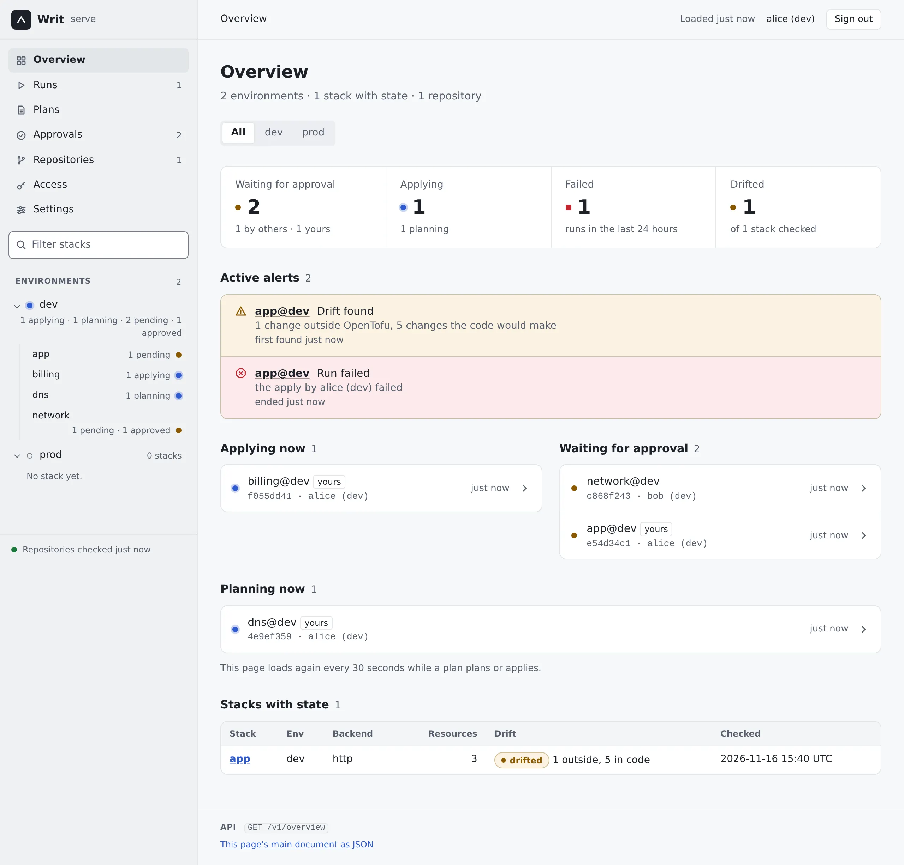

# Writ

**Plan, approve, and apply OpenTofu on your own server.**

Writ is an open-source, self-hosted control plane for [OpenTofu](https://opentofu.org). Point it at a Git repository of stacks. When you or a CI job send a commit, Writ plans it on your server, waits for your team to approve that exact plan, and applies it. CI jobs and laptops never hold cloud credentials or state keys.

Writ ships as one Go binary under the Apache 2.0 license, with no limits on users, runs, or resources. A team server stores records in Postgres; local development (`writ serve --dev`) uses SQLite on loopback.

<picture>
  <source media="(prefers-color-scheme: dark)" srcset="website/public/ui/overview-1280-dark.webp">
  
</picture>

## What it does

- **Server-side plans.** You or a CI job submit a commit SHA. `writ serve` fetches that commit from GitHub or GitLab and runs `tofu plan -lock=false` in an isolated Linux namespace without modifying state.
- **Plan-bound approvals.** Reviewers approve a plan by its plan ID, and `writ apply --remote` runs that exact saved plan. Wherever an approval rule applies, the plan's author can't approve it. [Approvals](docs/approvals.md)
- **Split cloud roles.** Plans run with your `plan_role` (which you keep read-only). Only an approved apply, or an override with a recorded reason, gets `apply_role`. [AWS roles and credentials](docs/aws-credentials.md)
- **Secret masking.** Writ strips secrets from every plan, run log, diagnostic, and state index row it stores or serves. [Secrets and the mask](docs/secrets.md)
- **Rego policy.** Writ evaluates OPA Rego policy sets at plan time and again before apply. Mandatory denials can't be overridden. [Write and test policies](docs/write-a-policy.md)
- **Drift checks and notifications.** Writ schedules drift plans and notifies Slack or webhooks, optionally signed, on drift, failed plans or applies, completed applies, out-of-band state writes, and pending approvals. [Drift checks](docs/drift-checks.md), [Notifications](docs/notifications.md)
- **Run isolation and egress control.** On a team server, each OpenTofu step runs under a dedicated UID in private Linux namespaces, with an opt-in egress proxy. Cgroup resource limits and a seccomp filter apply where the host allows them, and `writ serve --check` says whether they do. [Run isolation and egress](docs/run-isolation.md)
- **UI, CLI, API, imports, and MCP.** Review and approve plans in the built-in web UI or script everything with `--json`. Generate `resource` and `import` blocks with `writ import bulk`, or expose read-only planning to coding agents through `writ mcp`. [Import many objects](docs/import-bulk.md), [Use Writ with an agent](docs/agents.md)

## Quick start

`writ serve --dev` runs a single-user control plane on loopback with SQLite, no sign-in, and no cloud account.

Requirements: Linux, [`minisign`](https://jedisct1.github.io/minisign/), Git, and [OpenTofu 1.13.9](https://opentofu.org/docs/intro/install/) on `PATH`.

1. Install `writ` v0.1.9 (verifies the minisign signature and SHA-256 checksum, then installs to `~/.local/bin`):

   ```sh
   curl -fsSL https://github.com/mr-karan/writ/releases/download/v0.1.9/install.sh | sh
   export PATH="$HOME/.local/bin:$PATH"
   ```

2. Start the dev control plane and leave it running:

   ```sh
   writ serve --dev
   ```

3. In a second terminal, create a repository with one stack (`.tf` files plus a committed `.terraform.lock.hcl`) and register it:

   ```sh
   export PATH="$HOME/.local/bin:$PATH"
   mkdir -p ~/writ-demo/app
   cd ~/writ-demo
   git init -b main
   cat > app/main.tf <<'EOF'
   terraform {
     backend "http" {}

     required_providers {
       random = { source = "hashicorp/random", version = "3.9.1" }
     }
   }

   resource "random_pet" "name" {
     length = 2
   }
   EOF
   (cd app && tofu providers lock)
   git add .
   git commit -m "one stack"
   writ repo add .
   ```

4. Plan the commit and apply the plan by ID:

   ```
   $ cd app
   $ writ plan --remote
   OpenTofu 1.13.9 plan of app@dev

     + random_pet.name (create)

   Plan: 1 to add, 0 to change, 0 to destroy.
   Plan 3f613cf08763b0bf56626574288f85af for dev (app), by alice (dev), expires 2026-11-16T04:40:49Z.
   It needs no approval. Apply it with: writ apply --remote 3f613cf08763b0bf56626574288f85af
   $ writ apply --remote 3f613cf08763b0bf56626574288f85af
   OpenTofu apply of app@dev
     random_pet.name: create complete
   Apply: 1 added, 0 changed, 0 destroyed.
   State version 1 of app@dev.
   ```

   Output of a real run, 2026-11-15, with some lines cut.

Open the control UI link printed by `writ serve --dev` to inspect the plan and run in your browser. Next, follow [set up Writ for a team](docs/quick-start.md#set-up-writ-for-a-team).

### Connect GitHub Actions

Point `writ serve` at GitHub with a fine-grained read token (**Contents: read** and **Metadata: read**; a GitHub App is not built yet) and a `github-actions` OIDC issuer:

```hcl
issuer "github" {
  kind     = "github-actions"
  identity = "github"
  url      = "https://token.actions.githubusercontent.com"
}

forge "github" {
  kind            = "github"
  read_token_file = "/run/secrets/writ/github_read"
}

repo {
  name    = "infra"
  forge   = "github"
  project = "acme/infra"
}
```

Generate the workflow (a per-stack plan matrix plus one required check named `writ`, skipping fork and Dependabot PRs) and matching server grants with:

```sh
writ ci github --repo infra
```

Each job requests its own GitHub Actions ID token and runs `writ plan --remote --slot-wait 15m` without a checkout or cloud keys; people approve and apply. See [Set up GitHub Actions](docs/set-up-github-actions.md) and [Webhooks](docs/webhooks.md).

Also works with GitLab: see [Add a repository](docs/add-repository.md#forges-and-their-tokens) and [Set up GitLab CI](docs/set-up-gitlab-ci.md).

## Install

- **Install script:** Downloads the release binary, checks its minisign signature and SHA-256, and writes `~/.local/bin/writ`.
- **Container image:** `ghcr.io/mr-karan/writ:0.1.9` bundles `writ` and OpenTofu 1.13.9 for team servers.
- **Nix:** `nix run github:mr-karan/writ -- version`, plus `nixosModules.writ-serve` for a NixOS host with Postgres.
- **From source:** Go 1.27.3+ and `just` (`just build` writes `bin/writ`).
- **Release binaries:** Static binaries for Linux and macOS on amd64 and arm64. macOS binaries are cross-built on Linux and haven't been tested on macOS.

See [Install](docs/install.md) for commands and verification steps.

## Supported platforms and limits

- **OpenTofu only.** Writ runs OpenTofu 1.13.9 exclusively and doesn't run Terraform. Each stack has one state, with no `tofu workspace`.
- **GitHub and GitLab.** GitHub (github.com or GitHub Enterprise Server, from v0.1.9) and GitLab are the remote Git hosts Writ reads with a read-only token; there is no GitHub App yet. `writ ci github` and `writ ci gitlab` write the CI config (`writ serve --dev` also reads local Git directories).
- **AWS roles only.** Built-in role assumption supports AWS IAM roles via STS. Other providers get credentials from `provider_env` secret files on the server.
- **One node, on Linux.** A team `writ serve` runs as a single process on Linux with namespace isolation. Running a second process against the same database fails the first process's in-flight work.
- **Stand-in test suite.** End-to-end tests run real OpenTofu 1.13.9 and real providers against local stand-ins in isolated namespaces; no test contacts a live cloud account.

See [Supported platforms and limits](docs/status.md) for the full list and test coverage.

## Documentation

Read the docs at [writ.mrkaran.dev/docs](https://writ.mrkaran.dev/docs) or in [`docs/`](docs/README.md):

- [Quick start](docs/quick-start.md): local dev setup, then a team server with approvals.
- [Run a server](docs/run.md) and [Server config](docs/config.md): deployment and configuration.
- [Set up GitHub Actions](docs/set-up-github-actions.md) and [Set up GitLab CI](docs/set-up-gitlab-ci.md): OIDC-authenticated CI plans and workflows.
- [Commands](docs/commands.md), [API](docs/api.md), and [Errors](docs/errors.md): CLI, HTTP routes, and error classes.
- [How a plan becomes an apply](docs/plan-to-apply.md) and [Security model](docs/security-model.md): execution lifecycle and trust boundaries.
- [Writ vs other control planes](docs/compare.md) and [Writ vs plain GitLab CI](docs/compare-gitlab-ci.md).

## Contributing

Bug reports, design questions, and pull requests are welcome. Read [CONTRIBUTING.md](CONTRIBUTING.md) before sending a change. Report security issues privately per [SECURITY.md](SECURITY.md).

## License

[Apache 2.0](LICENSE). `proto/tfplugin5.proto` and `proto/tfplugin6.proto` are copied from OpenTofu under MPL 2.0; see [NOTICE](NOTICE).
