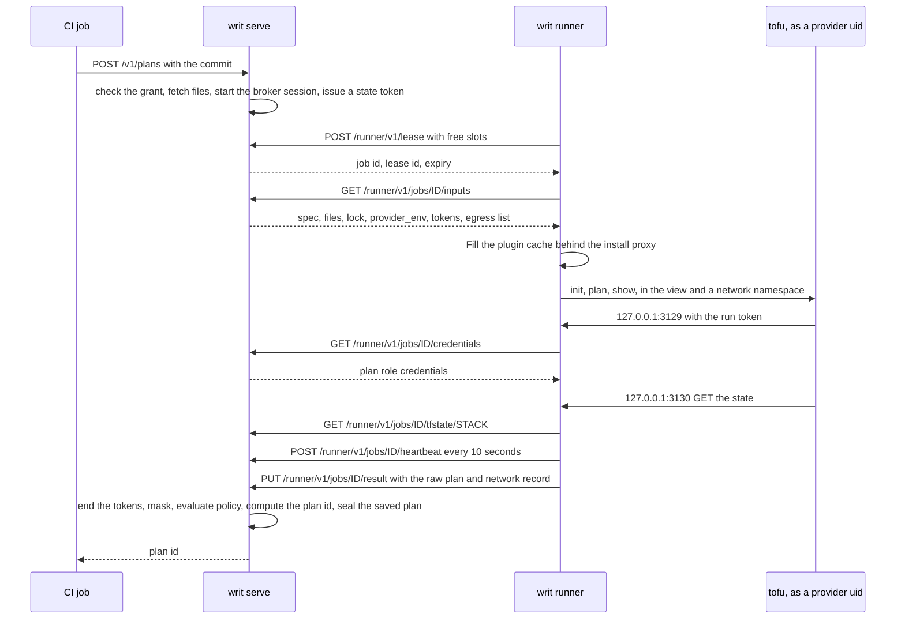
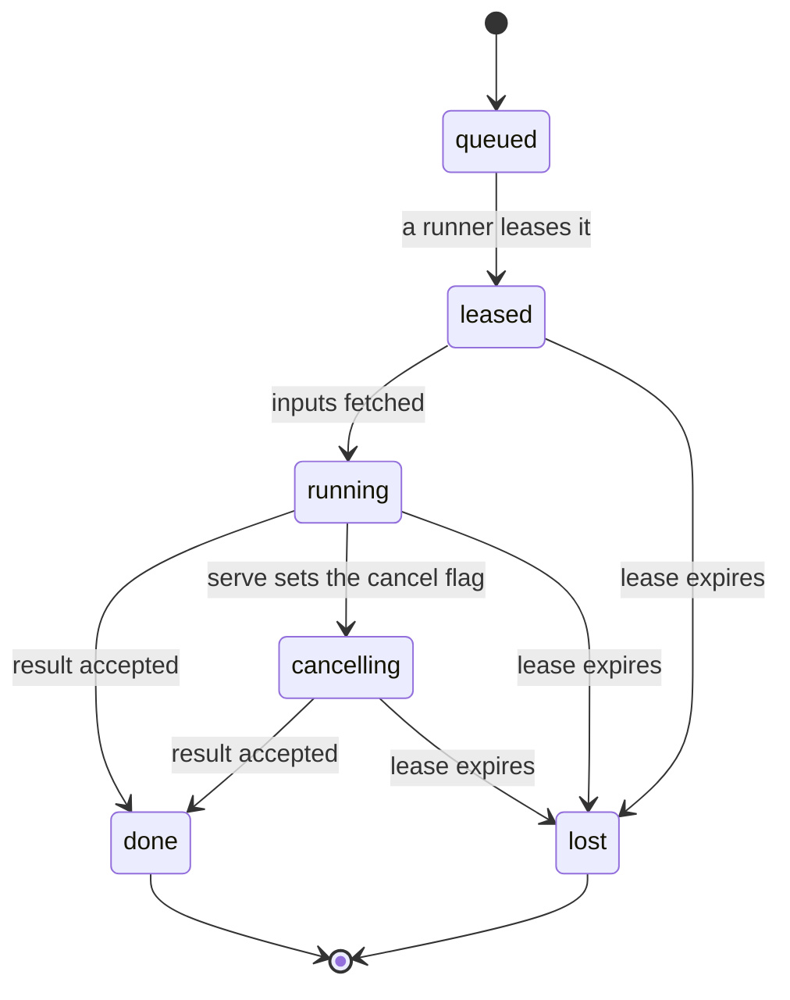

# Separate runners

Status: proposal, 2026-11-20. Only phase 0, the executor seam, is built: see [Phase 0 done](#phase-0-done). This page is a design document for contributors and the owner. It isn't on the docs site, and `website/content.manifest.ts` doesn't list it.

## Summary

Today one host runs `writ serve` and every OpenTofu run. That host holds every trust anchor of the control plane, and it also runs third-party providers and modules from unmerged branches. The sandbox has many layers, but a kernel bug or a bug in Writ's view setup turns code in a run into code on the host, and from there into every anchor.

This design moves runs to **runners**: `writ runner`, the same binary, on separate hosts that dial out to `writ serve` over mutual TLS and pull runs from it. `writ serve` keeps every key, the database, the node's AWS identity, the forge tokens, and the OIDC client secret. A runner gets only what one run needs, for as long as it runs. The mask, sealing, the plan id, and policy stay on `writ serve`, in the code that does them today. Role credentials still come from `writ serve`'s broker, relayed through the runner, so the mask still knows every credential a run was served. Today's in-process mode stays the default for small installs.

## Terms

- **Runner.** A `writ runner` process on its own host. It runs OpenTofu in today's sandbox: provider uids, the filesystem view, and a network namespace per step.
- **Pool.** A named group of runners. An environment's config says which pool its runs go to.
- **Job.** One OpenTofu run of `writ serve` sent to a runner: a plan, a drift check, an apply, or a state read for the index or an adoption. The user docs keep the glossary's terms. "Job" is a protocol term here.
- **Lease.** A runner's time-bound right to execute one job, renewed by heartbeats. It isn't a state lock, and the state's lock keeps working as it does today.

## 1. Threat model

### Trust anchors today

Every anchor lives on the `writ serve` host, readable by `writ`'s uid or held in its memory.

| Anchor | Where it lives | What it unlocks |
| --- | --- | --- |
| The node's AWS identity | Instance metadata, environment variables, or shared files that the AWS SDK's default chain finds | `sts:AssumeRole` on every `plan_role` and `apply_role` of every env, with any `SourceIdentity` the trust policies allow |
| Control database credentials | Postgres peer authentication as `writ`, or a password in `database` | Every row: plans, approvals, sealed states, sealed saved plans, sealed secret sets, token hashes, the audit log |
| Per-env keys | `env "NAME" { key = ... }` files, cached in memory by `stateKey` | Unsealing every state on the http backend, every saved plan, and every secret set of that env |
| Forge tokens | `read_token_file` and `write_token_file` of each `forge` block | Reading, and with the write token writing, every repository the tokens reach |
| OIDC client secret | `client_secret_file` of a `people` issuer | Acting as Writ's OAuth client at the identity provider |
| TLS key | `tls { key = ... }` | Impersonating `writ serve` |
| `provider_env` values | The files each env's `provider_env` points to | Whatever those tokens reach, such as a Nomad cluster |
| Live run material | `writ serve`'s memory: each run's broker token, state token, and served role credentials | The roles and states of the runs in flight |

### What code in a run reaches today

Code the commit chose runs inside the run: a provider binary the lock file pins, a module from a remote source, or a program in the stack's files that a provisioner starts. It starts as one of `provider_uids`, in its own user, mount, and pid namespaces, with no capabilities, `no_new_privs`, and a read-only tmpfs root. Under `egress_mode` report or enforce, it also has its own network namespace. From there it can do the following.

1. Read its own environment. The plan and apply steps have the env's `provider_env` values, the `TF_VAR_` values, the credential endpoint's URL and the run's token, and the state backend's address with the run's state token.
2. Fetch the env's plan role credentials, or the apply role's during an apply, from the broker at `127.0.0.1:3129` or the broker's host loopback port. The broker refreshes them until the run ends (`internal/awsrole/broker.go:112`).
3. Read its stack's state, and during an apply lock and write it, through the state token. On S3 it reaches whatever the role's S3 policy allows, which can include other stacks' keys.
4. Use the network. Under `off`, that's everything the host reaches except the metadata service, which the nftables rule blocks for provider uids: `writ serve`'s own listener, Postgres if it listens on TCP, the private network, and the internet. Under `enforce`, it's only the env's `egress` list through the proxy, and `*.amazonaws.com` still lets data out to any bucket.
5. Send what it read anywhere that step 4 reaches.

Each layer stops one thing:

| Layer | What it stops |
| --- | --- |
| A provider uid per run, with no groups | Reading another run's environment or scratch directory, and signalling `writ serve` |
| User, mount, and pid namespaces with `pivot_root` onto a read-only tmpfs | Reading the host's files: keys, `data`, `provider_env` files, the TLS key, shells |
| No capabilities, an empty bounding set, `no_new_privs` | Gaining privilege back through setuid binaries or file capabilities |
| `writ serve` marked not dumpable | Tracing `writ serve` or reading its memory from `writ`'s uid |
| The nftables metadata rule | The host's instance identity |
| A network namespace and the egress proxy, under report or enforce | The host's loopback, the private network, and unlisted hosts |
| Per-run tokens | State and credentials beyond the run's stack, role, and lifetime |
| The mask | Secrets in anything stored or shown |

### What an escape reaches today

What's left is the kernel, and Writ's own setup code that runs with `CAP_SETUID` and `CAP_SETGID`. An unprivileged process in a user namespace reaches a large part of the kernel. A bug there, or in the view helper (`internal/tofu/view_linux.go`), gives the attacker root or `writ`'s uid on the host.

From `writ`'s uid, the attacker reads every per-env key and unseals every state, saved plan, and secret set. They connect to Postgres by peer authentication and read every row. They read the forge tokens, the OIDC client secret, the TLS key, and every env's `provider_env` files. The nftables rule covers only provider uids, so they reach the metadata service and take the node's identity, which can assume every role of every env with any `SourceIdentity` they choose. As root, they can also replace the `writ` binary or its config and watch every later run.

So one escape reaches every anchor in the table above. Atlantis is in the same position, and its security page warns about it ([compare.md](../compare.md) cites it, read 2026-11-15).

### Where each anchor lives after the change

| Anchor | After the change |
| --- | --- |
| The node's AWS identity | `writ serve` host only. Runner hosts need no AWS identity at all, so their instance metadata can be turned off |
| Control database credentials | `writ serve` host only. Runners get no route to Postgres |
| Per-env keys | `writ serve` host only |
| Forge tokens | `writ serve` host only. `writ serve` fetches the commit's files and sends them with the job |
| OIDC client secret | `writ serve` host only |
| TLS key of `writ serve` | `writ serve` host only |
| `provider_env` values | Files on `writ serve` only. The values of one env cross to a runner of that env's pool inside each job, because they're handed to providers by design |
| Live run material | Each job's broker token, state token, and served credentials reach the runner that leases it, and die with the job |
| New: each runner's key | On its runner. It lets the runner lease jobs of its own pool until someone revokes it |
| New: enrollment tokens | Hashed in the control database. Each lets one host register a runner key in one pool |

### What a runner compromise reaches

An escape on a runner host reaches what jobs bring to that host while they run there:

- the `provider_env` values of the job's env,
- the broker and state tokens of the job, and the role credentials the broker serves through them,
- the stack's files, and the saved plan of an apply or the plaintext state of an index or adoption read,
- the raw output of the job, before any mask,
- the runner's key, which leases more jobs of the same pool until revoked,
- the runner host's network position.

It can also forge what its jobs report: a plan document that doesn't match the saved plan, a network record, or the serial an apply on S3 claims.

It doesn't reach any per-env key, the database, the node's identity, the forge tokens, the OIDC client secret, `writ serve`'s TLS key, anything sealed at rest, or any job of another pool.

Three controls bound the damage. A pool per env, and a separate pool for applies, keep a runner that ran a merge request's plan away from apply credentials and from other envs. Ephemeral runners, one job per host lifetime, take away persistence (phase 2). Revoking a runner key ends its leases and relays at once.

### What runners don't change

- **An apply runs the applied commit's code with the apply role.** A malicious provider or module in the merged commit does whatever the apply role allows, on any runner. Code review of the commit, including its lock file, is the control for that. Approving the masked plan isn't.
- **The masked plan and the saved plan come from the same run.** `writ serve` can't check that `tofu show -json` rendered the saved plan it got without running providers itself. Today the run is on the same host, so a run that escapes owns both anyway. With runners, a compromised runner can return a benign plan document and a different saved plan. [Open question 8](#8-check-at-apply-time-that-the-saved-plan-shows-the-approved-changes) proposes a check at apply time that a fresh runner makes.
- **A related gap exists today, unchanged by this design.** `tofu.Runner.Plan` reads `tfplan` after the `show` step (`internal/tofu/tofu.go:246` and `:250`), and the run's uid can write its scratch directory during `show`. If `tofu show -json` starts providers to load their schemas, a provider can swap `tfplan` after `show` read it, so the bytes `writ serve` seals differ from the bytes the plan document shows. This is inferred from the code and not tested. [Open question 9](#9-read-tfplan-before-the-show-step) proposes the fix.
- **The network record is the runner's word.** Today the egress proxy runs in `writ serve`, so a run that escapes its namespace still can't forge what the proxy recorded. On a runner, the proxy runs on the runner host, and a root escape there can rewrite the record. Enforcement on the runner host is as strong as that host. A firewall at the pool's edge is the backstop.

## 2. Architecture options

### What crosses the boundary in every option

The three options differ in how a run reaches an isolated machine, not in what it needs. Each needs these crossings.

| Crossing | Direction | Content | Notes |
| --- | --- | --- | --- |
| Job spec | serve to runner | Kind, env, stack, directory, deadlines, the env's egress mode and list, `provider_registries` | No secret but the tokens below |
| Commit files | serve to runner | The files `repo.TofuSources` gathered, at most 2,000 files and 64 MiB, with their source digest | `writ serve` fetched them with its forge token. The runner never talks to the forge |
| Lock file | serve to runner | The stack's lock file, or the copy moved to OpenTofu's registry | |
| `provider_env` values | serve to runner | The job's env only | Plans, drift checks, applies, and state reads on S3 get them. Reads of a stored state get none |
| Run tokens | serve to runner | The broker token and the state token of this job | Both end when the job ends |
| Role credentials | serve to runner, relayed per request | What the broker serves for the job's token | See [section 3](#3-credentials-on-runners) |
| State reads and writes | both ways, relayed per request | The http backend's `GET`, `POST`, `LOCK`, `UNLOCK` with the job's token | S3 stacks reach their bucket directly with the relayed credentials |
| Saved plan | serve to runner | The opened saved plan, apply jobs only | `writ serve` opened and checked it against the plan id first |
| Stored state | serve to runner | The opened state version, index and adoption reads on the http backend only | |
| Provider plugin cache | stays on the runner | Filled by the runner's agent user, behind its install proxy | Phase 2 can add a mirror on `writ serve`, see [open question 7](#7-fill-the-plugin-cache-on-each-runner-or-mirror-it-from-writ-serve) |
| Raw result | runner to serve | `tofu.Plan`, `tofu.Applied`, or `tofu.State`, or a `tofu.StepError` with its stdout and stderr | Only the mask on `writ serve` reads it, as today |
| Network record | runner to serve | Every destination the install and the run asked for, with its verdict | Raw. `writ serve` sweeps the hosts with the run's mask, as today |
| Filled lock file | runner to serve | The lock file Fill returned, with the hashes it recorded | So the apply checks the hashes the plan used |
| Heartbeats and cancellation | both ways | Lease renewal, and a cancel flag in the answer | |

So in every option, `writ serve` masks, seals, computes the plan id, evaluates policy, and keeps the secret sets. The runner returns raw output and never needs a key, a secret set, or the database.

### Option A: runner agents that dial out

`writ runner` runs on each runner host as a long-lived service. It holds a key pair that `writ serve` registered at enrollment. It opens a mutual TLS connection to a listener of `writ serve` that's only for runners, long-polls for a job, fetches the job's inputs, and runs the job with `internal/tofu`, as `writ serve` runs it today. Runner hosts need no inbound port.

- **Sandbox and egress.** Unchanged. The runner has its own `provider_uids`, nftables rule, plugin cache, and scratch directory. Each step's network namespace gets the same three ports. On `127.0.0.1:3128` the runner serves an `internal/egress` proxy built from the job's egress list. On `3129` and `3130` it relays to `writ serve`'s broker and state backend, over its own TLS connection, with the run's token.
- **Failure and cancellation.** Heartbeats renew the lease. A runner that can't renew kills its job, as a tofu child dies with `writ serve` today through `PR_SET_PDEATHSIG` (`internal/tofu/view_linux.go:748`). `writ serve` fails the job when the lease expires. [Section 5](#lease-heartbeat-cancellation-and-failure) has the timings.
- **Scaling.** Add hosts to a pool. Each runner offers as many slots as it has free provider uids, up to its `jobs` setting. `limits.plans` and `limits.applies` stay global on `writ serve`.
- **Operations.** One more NixOS module or systemd unit per runner host, an enrollment token per host, and a firewall rule that lets runner hosts reach the runner listener and nothing else of the control plane.
- **Self-hosting fit.** The best of the three. Same binary, same Nix package, same `--check` style, no new infrastructure.

Other control planes work this way. HCP Terraform agents poll for work over outbound HTTPS and need no inbound connection ([agent requirements](https://developer.hashicorp.com/terraform/cloud-docs/agents/requirements), read 2026-11-20). Spacelift's private workers make outbound connections only, over MQTT or HTTP long-poll ([worker pools](https://docs.spacelift.io/concepts/worker-pools), read 2026-11-20). OTF's `otf-agent` joins a pool with a token that belongs to that pool ([runners](https://docs.otf.ninja/runners/), read 2026-11-20).

### Option B: dispatch to a scheduler

`writ serve` creates a Nomad batch job or a Kubernetes Job for each run. The task starts the runner in one-shot mode, which takes exactly that job and exits.

- **What crosses.** The same table, plus a bootstrap secret in the scheduler's job spec, because the task must still dial back to `writ serve` to fetch inputs and return results. That secret sits in the scheduler's state store, Nomad's Raft log or Kubernetes' etcd, and anyone who can read job specs sees it. A single-use enrollment token, bound to one job and valid for minutes, keeps that exposure small.
- **New anchor on `writ serve`.** A scheduler credential that can submit jobs in one namespace. Whoever steals it runs workloads there. Whoever controls the scheduler decides where runs land and can read their specs.
- **Sandbox and egress.** Harder. Inside a container, the view needs to create a user namespace and mount in it, and needs `CAP_SETUID` and `CAP_SETGID` to map the provider uid. Container runtimes' default seccomp profiles refuse unprivileged `unshare` of a user namespace, so the task needs a relaxed profile or a privileged container. That weakens the container boundary the option is meant to add. This is inferred from the runtimes' defaults and not tested here. Kubernetes NetworkPolicy matches IP addresses, not host names, so the egress proxy still has to run inside the task.
- **Failure and cancellation.** The scheduler restarts or reschedules. `writ serve` stops a job by deleting it, and the lease logic of option A still decides what counts as done.
- **Scaling.** The scheduler's. Good for bursty drift checks.
- **Operations and self-hosting.** You must run the scheduler. It suits teams that already run Nomad or Kubernetes, and it's a second deployment story for everyone else.

Option B is option A's one-shot mode plus a launcher. It needs the protocol of option A anyway.

### Option C: a microVM per run

A runner host with `/dev/kvm` boots one Firecracker microVM for each job. The guest has a read-only root with `writ`, `tofu`, and `git`, a read-only drive with the plugin cache, a scratch drive, and no network interface. Its only channel is vsock to the host's runner agent, which relays the three ports and the job's inputs and result.

- **What crosses.** The same table, between `writ serve` and the host agent. The guest never talks to `writ serve`, so the runner's key stays on the host, outside the guest.
- **Sandbox and egress.** The strongest. A guest kernel bug stays in the guest, and each guest dies after its job. The guest has no network interface, so every connection goes through the host's egress proxy, and enforce is the natural mode. Today's provider uid and view can still run inside the guest as an extra layer.
- **Failure and cancellation.** The host agent kills the VM. The lease logic of option A applies unchanged.
- **Scaling.** Hosts with KVM: bare metal, or cloud instances that offer KVM to guests.
- **Operations and self-hosting.** The heaviest. It needs the `firecracker` and `jailer` binaries, a guest kernel, a root image, and a pipeline to build them. Nix can build all of them, but it's several artifacts, not one binary.

Option C is also option A's protocol, with a host agent that launches a VM instead of a sandboxed process.

### Comparison

| | A: agents dial out | B: scheduler | C: microVM |
| --- | --- | --- | --- |
| New anchor on `writ serve` | none beyond runner registrations | a scheduler credential | none beyond runner registrations |
| Bootstrap secret exposure | one enrollment token per host | a token per job in the scheduler's state | one enrollment token per host |
| Today's sandbox | unchanged | needs a relaxed container profile | unchanged, inside a VM |
| Egress proxy | on the runner | inside the task | on the host, the guest has no NIC |
| Isolation from a kernel bug | separate host | separate node, shared with other tasks | separate kernel per job |
| Persistence after escape | until the host is replaced, unless ephemeral | the node's lifetime | none, the VM dies after the job |
| Operations | a service per host | a scheduler | KVM hosts and VM images |
| Single binary | yes | yes, plus a scheduler | no |

### Recommendation

Build option A. Give `writ runner` a one-shot mode from the start, so options B and C become launchers that start a one-shot runner and need no protocol change.

1. **Phase 0.** Put an executor seam inside `writ serve`, with today's in-process code as the only executor. No behavior changes.
2. **Phase 1.** Long-lived runner agents with pinned-key mutual TLS, per-env pools through `runs_on`, relayed credentials and state, a local egress proxy, and leases. In-process stays the default.
3. **Phase 2.** Ephemeral runners, one job per runner key, with launcher examples for Nomad and Kubernetes in the docs. Add the apply-time plan check.
4. **Phase 3, only if the owner wants it.** A microVM launcher on KVM hosts.

A single-host install keeps working with no config change, because an env with no `runs_on` runs in-process as it does today.

## 3. Credentials on runners

### Relay the broker (recommended)

`writ serve` keeps calling `sts:AssumeRole` as its own identity, with the session name and `SourceIdentity` it sets today. `awsrole.Broker` keeps the session and its refresh. The job carries the run's broker token. Under `egress_mode` report or enforce, the step's environment on the runner points `AWS_CONTAINER_CREDENTIALS_FULL_URI` at `http://127.0.0.1:3129/v1/credentials`, as it does on `writ serve` today (`internal/server/launch.go:178`). Under `off`, it points at the runner's own loopback relay, as [section 4](#state-on-the-http-backend) explains. The runner forwards each request to `GET /runner/v1/jobs/{id}/credentials` on its own TLS connection. `writ serve` answers it with `Broker.Handler()` only when both checks pass: the token is the job's, and the job's lease belongs to the calling runner.

- **Refresh.** Unchanged. The broker assumes the role again 15 minutes before the credentials expire (`DefaultRefreshBefore`), and the AWS SDK fetches again.
- **Revocation at the end of a run.** `Run.End` drops the token, as today, and the lease check refuses any request after the job ends. Credentials a provider already fetched stay valid until they expire, as today.
- **The mask.** Unchanged. `tofuRun.mask` follows `Run.Secrets`, the secrets of every credential the broker served, because the broker is still on `writ serve`.
- **CloudTrail.** Unchanged. The session name is `writ-WHO-ID` and `SourceIdentity` comes from the verified principal. Calls with the credentials come from the runner pool's egress addresses. `writ serve` records the runner's id with each role session in `role_sessions`, which needs one column on SQLite and Postgres.
- **When `writ serve` is down.** Refresh fails, and state calls on the http backend fail too. A job loses its lease long before its credentials run out.

### A role for the runner (not recommended)

Each pool gets its own AWS identity, and the env roles' trust policies trust it. The runner assumes the plan or apply role itself.

- That puts a trust anchor back on the host that runs untrusted code. A root escape on a prod runner assumes the prod apply role whenever it likes, for as long as the attacker holds the host.
- The runner sets `SourceIdentity`, so a compromised runner writes whatever attribution the trust policy lets it.
- `writ serve` can't end a session at the run's end, and the mask learns the served secrets only if the runner reports them.
- Every environment's IAM setup changes.

It does keep working while `writ serve` is down, which matters little, because nothing else of a run works then.

| | Relay | Runner's own role |
| --- | --- | --- |
| Anchor on the runner | none | an identity that can assume env roles |
| Who sets `SourceIdentity` | `writ serve`, from the verified principal | the runner |
| Refresh | the broker, as today | the runner |
| Ends with the run | yes, the token and the lease | only if the runner cooperates |
| Mask knows served secrets | yes | only if the runner reports them |
| After a runner escape | credentials of jobs on that host while they run | any env role the pool's identity is trusted for, at will |
| IAM changes | none | a trust per pool |

### Hardening that the relay makes possible

- Turn off instance metadata on runner hosts, or give them an instance profile with no permissions. A runner needs no AWS identity.
- Add an `aws:SourceIp` or `aws:SourceVpc` condition to the plan and apply roles' permission policies, matching the runner pool's egress. Credentials that a run sends elsewhere then fail outside the pool. `writ serve` calls `AssumeRole`, so the condition goes on the permissions, not the trust policy.
- Keep the nftables metadata rule on runner hosts too. It costs nothing.

## 4. State and secrets

A runner never holds a per-env key, a secret set, or a database credential. Every state, saved plan, and secret set stays sealed in the control database, and only `writ serve` opens them.

### State on the http backend

The job carries a state token that `tfstate.Backend.Issue` created for the run, with the scope it has today: read for a plan, read, lock, and write for an apply. The step's `TF_HTTP_ADDRESS` points at `http://127.0.0.1:3130` on the runner, which relays each request to `/runner/v1/jobs/{id}/tfstate/...` on `writ serve`. `writ serve` serves it with the same `tfstate` handler, with its audit row, and adds the lease check. A stolen state token works only through the runner that leases its job, and only while it does.

Under `egress_mode = "off"`, a run on a runner shares the runner host's network, as runs on `writ serve` do today. The runner then serves the two relays on its own loopback, at random ports, behind the run's tokens, as the broker listens today. A run on a runner never reaches `writ serve`'s main listener with a state token.

### State on S3

Unchanged. The run reaches the bucket with the relayed role credentials, through the runner's egress proxy under report or enforce, and tofu takes the bucket's lock itself. `writ serve` reads the serial from the saved plan with `tofu.PlanSerial` (`internal/tofu/tofu.go:431`), as today.

### Reads for the index and adoptions

An index read on the http backend needs the stored state as a file. `writ serve` opens the newest version with the env's key and sends the plaintext in the job, as it hands the bytes to `tofu.Runner.Show` today. The job gets no credentials, no `provider_env`, and no state token, as today. A read on S3 pulls with the plan role, like a plan.

### Masking

The mask runs on `writ serve`, on the raw result the runner returns, with the same inputs as today: `provider_env` values, the run's tokens, every credential the broker served, and the secret set of the state the run read. `planMask` (`internal/server/tofuplan.go:280`) and `applyTofu` don't change. The runner masks nothing and needs no secret set. That matters, because a secret set holds past secrets that the current state may no longer show anywhere, and a runner has no need to learn them.

The network record comes back raw, and `writ serve` sweeps each host with the run's mask after the mask learns the plan, as it does today.

### Saved plans stay sealed and are applied exactly

1. The plan job returns `tfplan` and its `show -json`.
2. `writ serve` masks the JSON, computes the plan id over the masked plan, the saved plan's SHA-256, the commit, the stack, and the environment (`tofuPlanID`), and seals the saved plan with the env's key (`SealPlan`, `internal/tfstate/seal.go:120`).
3. At apply, `writ serve` opens the sealed saved plan, checks it against the plan id as `applyTofu` does today (`internal/server/tofuapply.go:78`), and sends the plaintext saved plan in the apply job, with its SHA-256.
4. The runner checks the SHA-256 and runs `tofu apply` of exactly those bytes.

The sealed copy never leaves `writ serve`, and the key never leaves it either.

### The same provider hashes for a plan and its apply

Today `tofu.Runner` keeps the hashes it recorded for OpenTofu's builds of `hashicorp/` providers in memory, so a plan and its apply on the same process check the same hashes. Across runners, the plan job returns the lock file Fill returned, `writ serve` keeps it with the plan, and the apply job's Fill checks the cache against it. That needs one column on SQLite and Postgres.

## 5. Job protocol

### Transport and listener

The protocol is HTTP/2 with JSON bodies, and binary bodies for files and raw output, from Go's standard library. That adds no dependency, and `internal/archtest` already keeps gRPC inside `provider`.

`writ serve` serves it on a listener of its own, with its own TLS block, separate from the API's. Many installs put a reverse proxy in front of the API, and a proxy that ends TLS also drops the client certificate. A separate listener also keeps the runner routes off the public API, and a firewall can open it to the runner network alone.

### Runner identity

**Enrollment.**

1. A person with `admin` on every env that the pool serves runs `writ runner token --remote --pool prod`. CI teams are refused, as they are for `override` and `adopt`. `writ serve` stores the token's SHA-256 with its pool, its uses left, one by default, and its expiry, one hour by default. It prints the token once.
2. On the runner host, `writ runner` generates an Ed25519 key, if it has none, with `crypto/rand`.
3. It calls `POST /runner/v1/enroll` over TLS, with no client certificate, sending the token and its public key.
4. `writ serve` checks the token with `crypto/subtle`, uses it up, and stores a runner row: id, pool, the key's SHA-256, `enrolled_at`, `expires_at`, and `last_seen`. It writes an audit row.

**Every later request.** The runner presents a self-signed certificate for its key. `writ serve` accepts the connection only when the key's SHA-256 matches a runner row that isn't revoked or expired, and it checks again on every request, so a revocation takes effect at once. There's no certificate authority and no signing key on `writ serve` to protect. The registration is the trust, as with an SSH key.

**Rotation.** Before `expires_at`, 30 days by default, the runner sends a new public key on `POST /runner/v1/rotate` over its current connection. `writ serve` swaps the row's key in one transaction. A runner that misses its expiry enrolls again with a new token.

**Revocation.** `writ runner revoke --remote ID` marks the row revoked. `writ serve` closes the runner's connections, refuses its relays, and fails its leased jobs. That ends their tokens and releases their locks on the http backend.

### Messages

| Route | Caller | What it does |
| --- | --- | --- |
| `POST /runner/v1/enroll` | a new runner, TLS only | Registers a public key with an enrollment token |
| `POST /runner/v1/lease` | runner | Waits up to 30 seconds for a job of the runner's pool. The body states free slots, the egress modes the host supports, the OpenTofu version, and the architecture. The answer is a job id, a random 128-bit lease id, and the lease's expiry |
| `GET /runner/v1/jobs/{id}/inputs` | runner | The job spec and its inputs as one stream, each part with its SHA-256 |
| `POST /runner/v1/jobs/{id}/heartbeat` | runner | Renews the lease. The answer carries the new expiry and a cancel flag |
| `GET /runner/v1/jobs/{id}/credentials` | runner, relaying | The broker's handler, with the run's token |
| `GET`, `POST`, `LOCK`, `UNLOCK` `/runner/v1/jobs/{id}/tfstate/...` | runner, relaying | The state backend's handler, with the run's token |
| `PUT /runner/v1/jobs/{id}/result` | runner | The raw result, once per lease |
| `POST /runner/v1/rotate` | runner | Replaces the runner's key |

Every job request carries the lease id in a header. Relayed state requests keep their audit rows, which gain the runner's id. Enrollment, rotation, revocation, each lease, and each result write audit rows too. Heartbeats don't, because one every 10 seconds per job would fill the log.

The job queue lives in `writ serve`'s memory, one queue for each pool. `writ serve` is a single process today, and its runs already end with it, so a table of jobs buys nothing until runs survive a restart. Only runner rows, enrollment tokens, and the two columns above need migrations.

### A plan, end to end



### Lease, heartbeat, cancellation, and failure



- **Timings.** The runner sends a heartbeat every 10 seconds, and a lease lasts 60. Both are settings of the `runners` block.
- **Self-fencing.** A runner that hasn't renewed for 45 seconds, measured on its monotonic clock, kills the job's process group and pid namespace and drops its output. That happens before `writ serve` gives up at 60 seconds, so a partitioned runner has stopped by the time `writ serve` declares the job lost. It's the remote form of today's `PR_SET_PDEATHSIG`, under which a run dies when it loses its control plane.
- **Lost jobs.** At lease expiry, `writ serve` ends the broker session, then fails the plan or run as `FailApplying` does (`internal/control/apply.go:1080`). The run's state tokens end and its locks on the http backend are released in that one transaction, so no late write lands after the lock is free.
- **Deadlines.** The job spec carries `limits.plan_timeout`, `limits.apply_timeout`, and `tofu.ApplyStop`, and the runner enforces them itself, as `tofu.Runner` does today. At the apply deadline it interrupts tofu, and tofu gets `ApplyStop` to write the state it reached. Heartbeats keep the lease alive through that window.
- **Cancellation from `writ serve`.** Serve sets the cancel flag. The runner kills a plan at once, interrupts an apply as at its deadline, and returns what it has.
- **A restart of `writ serve`.** Runs fail, as today, because the new process doesn't own them. The runner's next heartbeat finds no lease, and the runner kills the job. Surviving a restart is [open question 6](#6-survive-a-restart-of-writ-serve).

### Integrity and replay

- **Inputs.** TLS authenticates `writ serve` to the runner, against the system roots or the runner config's `ca_file`. Each input part carries its SHA-256, and the runner checks it. That catches a streaming bug, and TLS covers an attacker on the path.
- **Results.** `writ serve` accepts a result only on the live lease of the runner that holds it. A second upload with the same SHA-256 is a no-op, so a retry after a lost reply is safe. A different body, a result on an ended lease, or one from another runner returns 409 and leaves a `WARN` line.
- **Replay.** The lease id is random and single-use. Run tokens end with the job. Enrollment tokens are used up. TLS keeps the channel fresh.

### What `writ serve` trusts from a runner

It checks what it can. Everything else a runner sends is untrusted input, as raw tofu output is today.

- **Identity.** The pinned key decides the pool, and the pool decides which jobs the runner can lease.
- **Results are untrusted input.** Today's limit of 64 MiB for each output bounds them. Only the mask and `writ serve`'s own parsers read them. `writ serve` computes the plan id, seals the saved plan, and decides every status. No field a runner sends authorizes anything.
- **State writes.** They go through the state backend with the run's token, its scope, and the lock, as today.
- **What it can't check.** It can't check that the plan document renders the saved plan, that the network record is complete, or which serial an apply on S3 wrote. A runner's word on these is as good as the runner host. [Section 1](#what-runners-dont-change) states the limits, and the pool layout and ephemeral runners bound them.

## 6. Migration and testing

### Phases

**Phase 0: the seam.** Before phase 0, `startRun` in `internal/server/launch.go` both prepared a run on `writ serve` and built how it executes: a provider uid, `tofu.Net` handlers, and calls to `TofuRunner`. Phase 0 splits it into two parts, as [Phase 0 done](#phase-0-done) records.

- `writ serve` prepares: commit files, the broker session, the state token, and the secrets the mask starts from.
- An executor runs a job, a plain struct with no `http.Handler` and no `runas.User`, and returns a plain result: the raw tofu output, the filled lock file, and the network record.

The only executor in this phase is today's code. The mask, seal, policy, and plan id code doesn't change, and every existing test passes unchanged. The rest of the design builds on this split. A run is a job from the start, and in-process is one way to execute it.

**Phase 1: long-lived runners.**

- New package `internal/runner`. It owns the job and result types, the executor that today's `fill`, `stack`, and port setup become, the agent loop of `writ runner`, the protocol client, and the protocol's wire types, which stay in the package as `AGENTS.md` requires.
- `internal/server` serves the runner listener, keeps the queues, and checks leases on the relays.
- Migrations on SQLite and Postgres: runner rows, enrollment tokens, `role_sessions.runner`, and the plan's filled lock file.
- New `internal/archtest` rule: `runner` imports none of `control`, `tfstate`, `mask`, `oidc`, `authz`, `sqldb`, `policy`, or `forge`. Code on the runner's path then can't reach a key or the database, even by mistake.
- `writ runner --check`, with today's isolation checks plus a check that it can reach `writ serve` with a valid registration.
- Default unchanged: an env without `runs_on` runs in-process.

**Phase 2: ephemeral runners.** `writ runner --once` takes one job and exits. `pool "NAME" { ephemeral = true }` makes `writ serve` retire a runner's key after its first job, and refuse it a second lease. Launcher examples for Nomad and Kubernetes go in the docs, not the code. This phase also adds the apply-time plan check, and a provider mirror if measurements show runners spend their time filling the cache.

**Phase 3, optional.** A microVM launcher. It's a host agent around the phase 1 executor, with no protocol change.

### Config shape

`writ serve`'s config gains a `runners` block, `pool` blocks, and two env attributes:

```hcl
runners {
  listen = "10.0.1.10:7443"
  lease  = "60s"
  tls {
    cert = "/var/lib/writ/tls/runners.pem"
    key  = "/var/lib/writ/tls/runners-key.pem"
  }
}

pool "nonprod" {}

pool "prod-plan" {
  jobs = 8
}

pool "prod-apply" {
  jobs      = 2
  ephemeral = true
}

env "staging" {
  key     = "/var/lib/writ/keys/staging.key"
  runs_on = "nonprod"
}

env "prod" {
  key           = "/var/lib/writ/keys/prod.key"
  runs_on       = "prod-plan"
  apply_runs_on = "prod-apply"
}
```

- `runs_on` is the pool for every run of the env: plans, drift checks, applies, and state reads. Without it, the env's runs stay in-process.
- `apply_runs_on` is the pool for applies only, and defaults to `runs_on`. It keeps a merge request's code, which only plans run, off the hosts that hold apply credentials.
- `writ serve --check` refuses a `runs_on` without a `runners` block, a pool no env uses, and `ephemeral` before phase 2. It requires the `tofu` block and `provider_uids` only when some env runs in-process.

A runner has its own config, `writ runner --config /etc/writ/runner`:

```hcl
server            = "https://writ.example.com:7443"
ca_file           = "/etc/writ/runners-ca.pem"
pool              = "prod-plan"
key               = "/var/lib/writ-runner/runner.key"
enroll_token_file = "/run/secrets/writ-runner/enroll"
provider_uids     = "61000-61015"
jobs              = 8

tofu {
  binary       = "tofu"
  plugin_cache = "/var/lib/writ-runner/plugins"
  scratch_dir  = "/var/lib/writ-runner/runs"
  git          = "git"
}
```

The egress mode and lists stay in `writ serve`'s config, because the policy belongs to the control plane. The job carries them, and a runner refuses a job whose mode its host can't provide.

### Tests

- **Protocol units** in `internal/runner` and `internal/server`, over real TLS on loopback. Enrollment uses up a token, and an expired or used token is refused. A wrong or revoked key is refused, and a revocation mid-connection closes it. A lease expires and fails the job. A late result, a result from another runner, and a different second result each return 409. A duplicate result is a no-op. The relays refuse a token after its job ends, and through any runner but the leasing one.
- **Parity.** `servetest` gains a runner mode: `writ serve` and an in-process `writ runner` over real mutual TLS. The `server` package's OpenTofu tests run in both modes, and a test compares the masked documents of the same stack between modes byte for byte. `just e2e` runs `TestTofuApproveApply` and `TestTofuEgress` in runner mode too. `just verify-mask` runs in runner mode, because the mask's input now crosses a wire.
- **Isolation across hosts,** a new `TestRunnerIsolation` in `just e2e`. Two network namespaces joined by a veth pair stand for two hosts, each with its own mount namespace and data directory. `writ serve`, Postgres, the keys, and the forge and STS stand-ins are on one side. Only the runner's config is on the other.
  - **A canary sweep.** Every anchor on `writ serve` holds a unique canary value: each env key, the database password, the forge tokens, the OIDC client secret, the TLS key, and the `provider_env` values of an env on another pool. The runner records every byte it receives and every file under its directories. The test asserts that no canary appears, except the `provider_env` canaries of envs on the runner's own pool, and those only inside their own jobs.
  - **A probe in tofu's place,** as a provider uid on the runner, reaches neither Postgres nor `writ serve`'s main listener, and gets credentials only through its token.
  - **Faults.** Killing the runner mid-apply fails the run after the lease, ends its token, and releases its lock. Taking the veth down makes the runner kill its own job before `writ serve` declares it lost, so the job's processes are gone before 60 seconds pass. Revoking the runner mid-job ends its relays at once.

### Docs to write

- `docs/runners.md`, a guide: set up a runner pool, enroll a runner, route an env, and check it.
- `docs/config.md`: the `runners` and `pool` blocks, `runs_on`, `apply_runs_on`, and the runner's config.
- `docs/serve.md`: how a run reaches a runner, the relayed credential endpoint in [Roles and credentials](../serve.md#roles-and-credentials), and where the proxy runs in [Egress](../serve.md#egress).
- `docs/run-isolation.md`: runner hosts, with their `provider_uids`, the nftables rule, and metadata turned off.
- `docs/security-model.md`: a layer for separate runners, and a runner row in "Who holds what".
- `docs/architecture.md`: `runner` in the package map, the new archtest rule, and the data flow.
- `docs/glossary.md`: runner and pool.
- `docs/status.md`: the runner limits.
- `docs/compare.md`: the "Where a run executes" row.
- `CHANGELOG.md` under Unreleased.

## 7. Open questions for the owner

### 1. Run plans and applies on separate pools in prod

Recommendation: yes, as the documented production layout, with `apply_runs_on`. Merge request code runs only in plans, so it never shares a host with apply credentials. The cost is one more pool to run.

### 2. Pinned keys or a certificate authority for runner identity

Recommendation: pinned keys. A CA adds a signing key on `writ serve` and a revocation story. With pinned keys, `writ serve` checks every request against its own rows, and revocation takes effect at the next request.

### 3. Relay credentials only, or also allow a runner's own role

Recommendation: relay only. A runner role brings an anchor back onto the hosts this design empties, and it breaks the mask's knowledge of served credentials.

### 4. Allow `egress_mode = "off"` for runner pools

Recommendation: allow it, for parity, and have `writ runner --check` warn. Document enforce as the mode for runner pools. Requiring report or enforce would block stacks with clients that ignore proxy settings from moving to runners at all.

### 5. Trust the network record a runner sends

Recommendation: accept it, label it in the docs as the runner host's word, and advise a firewall at the pool's edge. The other choice, routing every connection through `writ serve`'s own proxy, makes the control plane the egress point of every run, next to its database. That undoes the separation.

### 6. Survive a restart of `writ serve`

Recommendation: not in phases 1 or 2. Runs die with `writ serve` today, and phase 1 keeps that. Resuming needs a jobs table, and the new process must rebuild each run's mask, including the credentials the old process served, which only the runner could report back. Revisit it together with running more than one `writ serve`.

### 7. Fill the plugin cache on each runner, or mirror it from `writ serve`

Recommendation: each runner fills its own cache in phase 1, so `writ serve` in an all-runner install needs no `tofu` block. In phase 2, measure an ephemeral runner's start. If the fill dominates, add a provider mirror on the runner listener, backed by today's Fill on `writ serve`, which runs no stack code and no provider. Every runner would then check the same hashes, and runners would need no registry egress.

### 8. Check at apply time that the saved plan shows the approved changes

Recommendation: yes, in phase 2. The apply job already returns `show -json` of the saved plan (`tofu.Applied.Plan`). `writ serve` would refuse the apply when the addresses and actions in it differ from the approved masked plan. That catches a compromised plan runner when the apply runs on a fresh one. It can't catch code in the applied commit, which runs in the apply too. Comparing whole masked documents would catch more, but the apply's mask knows different credentials, so measure false refusals first.

### 9. Read `tfplan` before the `show` step

Recommendation: fix it now, apart from this design, after a test confirms the gap. That test would use a provider that rewrites `tfplan` while `show` runs. If confirmed, `tofu.Runner.Plan` should read the saved plan as soon as the plan step's processes are gone, and have `show` read that copy from a path the run's uid can't write. The fix applies in-process and on runners alike.

### 10. Who can mint enrollment tokens

Recommendation: a person, never a CI team, with `admin` on every env the pool serves, through the API. The other choice, a local command on the `writ serve` host, avoids an API route but needs a shell on the control plane for every new runner.

## Sources

- HCP Terraform, [agent requirements](https://developer.hashicorp.com/terraform/cloud-docs/agents/requirements): agents poll for work and need only outbound connections. Read 2026-11-20.
- Spacelift, [worker pools](https://docs.spacelift.io/concepts/worker-pools): private workers make outbound connections, over MQTT or HTTP long-poll. Read 2026-11-20.
- OTF, [runners](https://docs.otf.ninja/runners/): `otf-agent` joins an agent pool with a token of that pool. Read 2026-11-20.
- Atlantis, [security](https://www.runatlantis.io/docs/security), as cited in [compare.md](../compare.md), read 2026-11-15.

## Decisions (2026-11-20)

The owner accepted every recommendation above:

1. Prod plans and applies can run on separate pools: an env sets `runs_on` for plans and `apply_runs_on` for applies.
2. Runners are identified by public keys pinned at enrollment, not by a certificate authority.
3. Credentials are relayed only: `writ serve` assumes the role and relays short-lived credentials through the runner's per-run endpoint. Runner hosts hold no AWS identity.
4. `egress_mode = "off"` is allowed on a pool, with a `--check` warning; `enforce` is the documented mode.
5. A runner's network record is accepted and documented as only as trustworthy as the runner host.
6. Runs don't survive a `writ serve` restart in phases 1 and 2.
7. Each runner fills its own plugin cache in phase 1.
8. Phase 2 checks at apply time that the saved plan shows the approved changes.
9. The `tfplan` read order is fixed now, apart from runners, once a test confirms the gap.
10. Only a person with `admin` on every env a pool serves can mint its enrollment tokens.

## Phase 0 done

Phase 0 landed on 2026-11-20 with no change in behavior. Every OpenTofu run of `writ serve` is now a job of an executor, and the only executor is in-process.

- **`internal/runner/runner.go`** has the job protocol's types. `Job` is plain data: the kind (`Plan`, `Apply`, `Show`, or `Pull`), the run's id, the commit's files and the stack's directory, the lock file, `Env` and `Creds` with the env's `provider_env` values and the run's tokens, `StateCreds`, `Egress` (the mode, the env's list, and `provider_registries`), and the opened saved plan of an apply or the opened state of a show. `Result` has tofu's raw `Plan`, `Applied`, or `State`, and `Network`, the raw record of both proxies. `Executor.Reserve` waits for a `Slot`, and `Slot.Run` runs one job, with the provider install under the run's start context and tofu under its run context. `StartError` is a job that failed before tofu ran, and `Refusal` is one an executor doesn't run, which `writ serve` reports with the class `usage`. `Tofu` is the old `server.TofuRunner`. The ports of a run's own network and its proxy environment live here too.
- **`internal/runner/local.go`** has `Local`, the in-process executor: today's `takeUID` and `freeUID` as `UIDs`, the work directory, the egress proxy, `fill` with its registry check and the install's proxy, and the ports. The state and credential ports reach `writ serve` through `Relay`, which `Server.relay` implements with the state handler and `Broker.Handler()`. Phase 1's remote executor relays them over its TLS connection.
- **`internal/server/launch.go`** keeps what `writ serve` prepares in `startRun`: the check of the commit's files, the `provider_env` values, the role session, and the slot, which it reserves where it took a uid, so a run still waits for its uid before its token is issued and its state version read. `tofuRun.job` builds the job and `tofuRun.run` runs it. `planTofu`, `applyTofu`, `refreshIndex`, `refreshS3`, `adoptShow`, and `adoptPull` call them, and mask, seal, compute the plan id, and evaluate policy as before. `server` holds no `Tofu` of its own, so no run reaches tofu but through the executor.
- **`internal/archtest`** refuses an import of `control`, `tfstate`, `mask`, `oidc`, `authz`, `sqldb`, `policy`, or `forge` from `internal/runner`. `TestJobIsPlainData` fails when `Job` or `Result` gains a function, a channel, a handler, a uid, or a type of a package that holds keys, the database, or the forge, such as a `*tfstate.Key`. `TestJobsCrossTheExecutor` records the jobs of a plan, its apply, an index refresh, and a drift check, and checks that none carries the env's state key or the forge's token.

Next: phase 1, long-lived runners.
